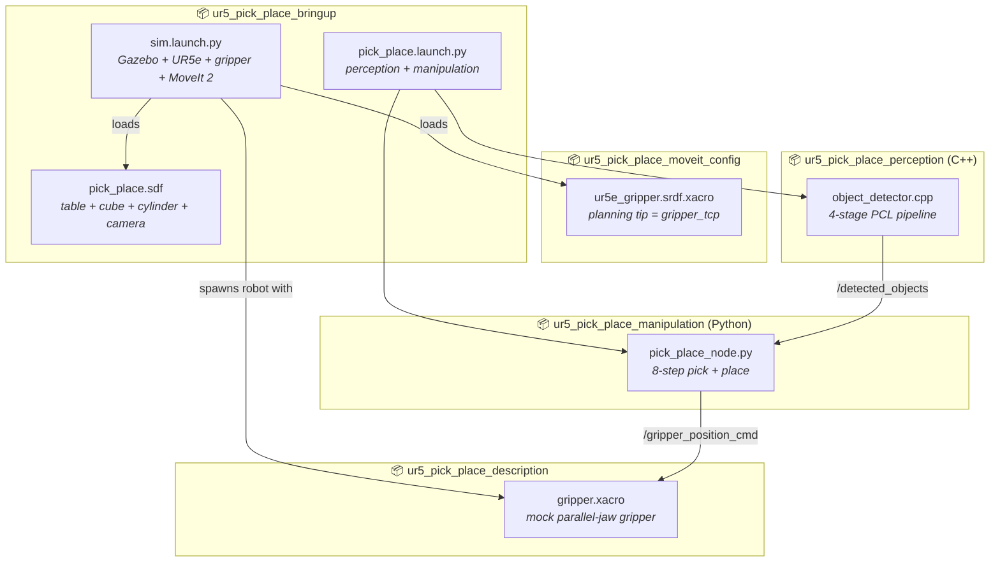

# ROS2 Vision-Based Pick and Place with UR5e

[](https://github.com/AakashKavi/pick-and-place-with-ur5/actions/workflows/ci.yml)

### Closing the loop between 3D point cloud perception and industrial arm motion planning — entirely in simulation, no custom robot configuration required.

---

##  Project Overview

Standard pick-and-place tutorials either skip perception entirely (hardcoded object positions) or skip manipulation (just detect, never act). This project builds the full pipeline: a depth camera sees objects on a table, a PCL-based perception node detects them, and MoveIt 2 commands a UR5e arm — fitted with a custom parallel-jaw gripper — to pick one up and place it on another.

The simulation runs on ROS2 Humble with the new Gazebo (gz-sim), using the official Universal Robots ROS2 driver as the base — the arm and controllers are stock, with a custom gripper and MoveIt config layered on top.

**Current status:** Full pipeline working end-to-end — perception detects the objects, MoveIt 2 plans collision-aware motions around a registered table, the gripper picks up the cylinder and places it on top of the cube.

---

## System Architecture

<p align="center">
  
</p>

---

##  Key Features

* **Full perception-to-manipulation pipeline** — depth camera → PCL clustering → MoveIt 2 pick-and-place sequence, all connected over ROS2 topics
* **Custom mock parallel-jaw gripper** — added on top of the stock UR5e, driven directly by a gz-sim `JointPositionController` plugin, sized to actually fit around the scene's objects
* **Pick-and-place, not just pick** — identifies the cylinder vs. the cube (via nearest-match against ground truth, since perception doesn't classify shape), picks the cylinder up and stacks it on the cube
* **Grasp target comes from Gazebo ground truth, not the raw detection**: a top-down camera only ever sees an object's top surface, so perception's detected z is biased high; the actual grasp pose is read from Gazebo directly, perception only confirms the object is currently visible, see Key Insight
* **Collision-aware planning** — the table is registered with MoveIt as a real `CollisionObject`, so motions are actually planned around it instead of just being statically unlikely to hit it
* **Mixed trajectory types per motion** — long transit moves use a cubic-spline joint trajectory (smooth single accelerate/decelerate blend, collision-checked per waypoint); short local moves (descend/retreat to grasp or place) use Cartesian linear interpolation so the end effector travels a straight line instead of an arbitrary joint-space path
* **Grasp verification + retry** — after closing the gripper, checks the object's actual Gazebo pose against the gripper's actual pose (not just the planned target) before declaring success; retries the whole approach up to 3 times if the grasp missed
* **Kinematic attach** — since the gripper doesn't grip via contact physics, a held object's Gazebo pose is teleported to track the gripper between waypoints
* **New Gazebo (gz-sim) compatible** — world file written in SDF 1.9 with gz-sim system plugins, not Gazebo Classic syntax
* **ros_gz_bridge integration**: explicit bridge nodes translate the depth point cloud, the gripper command topic, ground-truth model poses, and the kinematic-attach set_pose service between ROS2 and Gazebo, see Topics
* **C++ PCL perception node**: voxel grid downsampling, passthrough crop, then Euclidean cluster extraction by default; RANSAC plane removal is implemented and available behind an `enable_plane_removal` parameter (default false), not needed for this scene since the passthrough crop already excludes the table, see Key Insight
* **RViz marker visualization** — detected object centroids published as `visualization_msgs/MarkerArray` for real-time inspection
* **GitHub Actions CI** — automated build check on every push

---

##  System Requirements

* OS: Ubuntu 22.04 LTS
* Middleware: ROS2 Humble Hawksbill
* Simulation: Gazebo (gz-sim / Ignition Fortress)

Dependencies:
```bash
sudo apt install \
  ros-humble-ur \
  ros-humble-ur-simulation-gazebo \
  ros-humble-moveit \
  ros-humble-pcl-ros \
  ros-humble-ros-gz-bridge \
  ros-humble-gazebo-ros-pkgs \
  python3-scipy
```

---

##  Installation

```bash
# Clone into your ROS2 workspace
mkdir -p ~/ros2_ws/src
cd ~/ros2_ws/src
git clone https://github.com/AakashKavi/pick-and-place-with-ur5.git

# Resolve dependencies
cd ~/ros2_ws
rosdep install --from-paths src --ignore-src -r -y

# Build
colcon build --symlink-install
source install/setup.bash
```

---

##  Usage

Simulation and the pick-and-place operation are launched separately.

```bash
# 1. Launch the simulation: Gazebo + UR5e + gripper + MoveIt 2
ros2 launch ur5_pick_place_bringup sim.launch.py
```

Launch sequence:
1. Gazebo starts with the custom world (table, objects, depth camera)
2. MoveIt 2 move_group connects (5s delay)
3. Camera and gripper command bridges start

Wait for RViz/MoveIt to finish connecting, then in a second terminal:

```bash
# 2. Start perception + the pick-and-place manipulation node
ros2 launch ur5_pick_place_bringup pick_place.launch.py
```

This starts the perception node (publishing `/detected_objects`) and the
manipulation node, which picks up the cylinder and places it on the cube.

To verify the camera bridge is active:
```bash
ros2 topic info /camera/depth/points
# Expected: Publisher count: 1
```

To inspect detected objects:
```bash
ros2 topic echo /detected_objects
```

---

## Package Structure



| Package | Purpose |
|---|---|
| `ur5_pick_place_bringup` | Launch files, Gazebo world, gripper controller config |
| `ur5_pick_place_description` | UR5e + gripper xacro (overlay on `ur_description`) |
| `ur5_pick_place_moveit_config` | Custom SRDF + kinematics for the gripper-equipped arm |
| `ur5_pick_place_perception` | C++ PCL object detection node |
| `ur5_pick_place_manipulation` | Python MoveIt 2 pick-and-place execution node |

---

## Key Insight

### Gazebo Classic vs New Gazebo

The biggest debugging challenge in this project was not the perception or manipulation code. It was the camera.

`ur_simulation_gz` (the official UR ROS2 driver) runs on the **new Gazebo (gz-sim/Ignition)**, not Gazebo Classic. The two versions look similar on the surface but use completely different plugin architectures under the hood.

The initial world file used Gazebo Classic syntax (`libgazebo_ros_camera.so`, `<ros>` topic remappings). This produced no errors. It simply did nothing, silently, in the new Gazebo.

The fix required three changes:
1. Rewrite the world file in SDF 1.9 with gz-sim system plugins (`gz-sim-sensors-system`, `gz-sim-physics-system`, etc.)
2. Declare the camera sensor using gz-sim's native `depth_camera` type with a `<topic>` tag
3. Add an explicit `ros_gz_bridge` node in the launch file to translate `gz.msgs.PointCloudPacked` into ROS2 `sensor_msgs/PointCloud2`

### The passthrough crop is doing double duty

The perception pipeline's passthrough filter exists to crop the raw point cloud down to the workspace volume. For this specific scene it also happens to remove the table surface for free: the table top sits 0.80 m deep from the camera (camera at z=1.30, table top at z=0.500, see `pick_place.sdf`), and the crop's upper bound is 0.79 m, just short of that. That is why RANSAC plane removal (`removePlane()`, wired in behind the `enable_plane_removal` parameter, default false) is not needed in this scene. It will be needed again if the table height, camera mount height, or object sizes change enough to close that 0.01 m margin.

### Grasp target: Gazebo ground truth, not the raw detection

The arm does not grasp at the pose `object_detector` publishes. `pick_place_node` reads the cylinder's actual pose from Gazebo (via a `tf2_msgs/TFMessage` bridged from gz-sim's own `dynamic_pose/info` topic, see below) and builds the grasp target from that instead. The detected pose on `/detected_objects` is only used to confirm perception can currently see the cylinder, by nearest-position match against the ground truth pose, since perception does not classify shape.

The reason is geometric, not a shortcut. A single downward depth camera only ever sees the top surface of an object, never its center. Using the detected position directly would put the grasp target's z roughly one object half-height too high, closing the gripper above the cylinder's body instead of around it.

### QoS: why a subscriber can silently receive nothing

Every topic has a QoS (Quality of Service) profile on each side, publisher and subscriber independently. `/camera/depth/points` is subscribed to with `SensorDataQoS()` (best effort, volatile, shallow history) rather than the default, because it is high rate sensor data where dropping an old frame is fine and never worth blocking on. `/detected_objects` uses the plain default profile (reliable, volatile, depth 10) on both the publisher and subscriber side.

The rule that matters: a subscriber can only receive from a publisher if its QoS is equal to or weaker than what the publisher offers. A reliable subscriber against a best effort publisher is the classic mismatch, and it fails silently. No error, no crash, the subscription just never receives anything, which looks identical to "the publisher isn't running" from the subscriber's side.

To actually see this instead of guessing: `ros2 topic info /camera/depth/points -v` prints the full QoS profile for every publisher and subscriber on a topic, side by side. That `-v` is the first thing to reach for when a topic looks connected but nothing is arriving.

---

## Topics

| Topic / Service | Type | Direction |
|---|---|---|
| `/camera/depth/points` | `sensor_msgs/PointCloud2` | Camera → Perception |
| `/detected_objects` | `geometry_msgs/PoseArray` | Perception → Manipulation |
| `/detected_objects_markers` | `visualization_msgs/MarkerArray` | Perception → RViz |
| `/gripper_position_cmd` | `std_msgs/Float64` | Manipulation → Gripper (gz `JointPositionController`) |
| `/world/pick_place_world/dynamic_pose/info` | `tf2_msgs/TFMessage` | Gazebo → Manipulation (ground truth model poses) |
| `/world/pick_place_world/set_pose` (service) | `ros_gz_interfaces/SetEntityPose` | Manipulation → Gazebo (kinematic attach teleport) |

---

## Future Scope

* Fix ogre2 depth camera rendering to produce valid (non-NaN) point cloud values in headless Gazebo
* Replace centroid heuristic with learned grasp pose estimation (GraspNet or similar)
* Add gripper state feedback using a simulated force/torque sensor, and grip via real contact physics instead of kinematic attach
* Implement multi-object sequencing (pick and place all objects in order)
* Add eye-in-hand camera configuration as an alternative to fixed overhead mount
* Publish planned trajectories to RViz's `MotionPlanning` display for visualization

---

## Author

**Aakash Kavi** — Robotics and Automation Engineer  
M.Sc. Mechatronics, Hochschule Ravensburg-Weingarten  
LinkedIn: TODO add your profile link here | [GitHub](https://github.com/AakashKavi)
