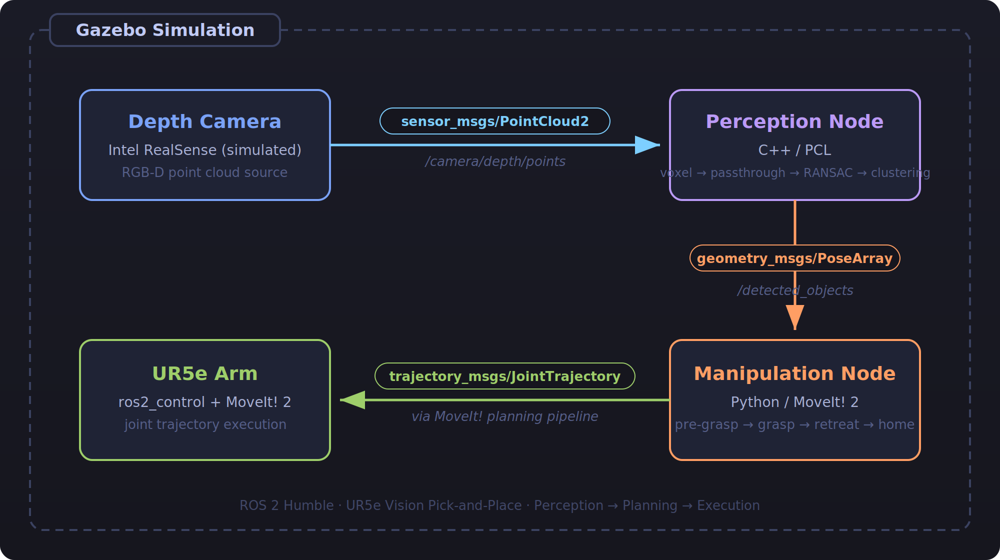

# ROS2 Vision-Based Pick and Place with UR5


A ROS2 Humble project demonstrating a full perception-to-manipulation pipeline using a simulated UR5e robot arm in Gazebo. A simulated depth camera detects objects on a table using 3D point cloud processing (PCL), and MoveIt! 2 plans and executes pick-and-place motions.

> **Status:** In development

---

## Demo

<!-- Replace with a GIF once the simulation is running -->


---

## System Architecture

<p align="center">
  
</p>

---

## Prerequisites

- Ubuntu 22.04
- ROS2 Humble
- Gazebo Classic (comes with `ros-humble-gazebo-ros-pkgs`)

Install dependencies:

```bash
sudo apt install \
  ros-humble-ur \
  ros-humble-ur-simulation-gazebo \
  ros-humble-moveit \
  ros-humble-pcl-ros \
  ros-humble-gazebo-ros-pkgs
```

---

## Build

```bash
mkdir -p ~/ros2_ws/src
cd ~/ros2_ws/src
git clone https://github.com/YOUR_USERNAME/ros2_ur5_vision_grasp.git
cd ~/ros2_ws
rosdep install --from-paths src --ignore-src -r -y
colcon build --symlink-install
source install/setup.bash
```

---

## Run

```bash
# Launch full simulation: Gazebo + MoveIt! + perception + manipulation
ros2 launch ur5_pick_place_bringup sim.launch.py
```

Open RViz to visualize detected object poses and planned trajectories.

---

## Package Overview

| Package | Language | Role |
|---|---|---|
| `ur5_pick_place_bringup` | Python | Launch files, Gazebo world, configs |
| `ur5_pick_place_perception` | C++ | Point cloud filtering, object clustering |
| `ur5_pick_place_manipulation` | Python | MoveIt! pick-and-place execution |

---

## Perception Pipeline

The perception node processes incoming `PointCloud2` data in four stages:

1. **Voxel Grid downsampling** — reduces point density for faster processing
2. **PassThrough filter** — crops the cloud to the robot workspace region
3. **RANSAC plane segmentation** — detects and removes the table surface
4. **Euclidean Cluster Extraction** — segments remaining points into individual objects

Each detected cluster centroid is published as a `geometry_msgs/PoseArray` with a fixed top-down grasp orientation.

---

## Manipulation Pipeline

The manipulation node subscribes to detected object poses and executes a four-step pick sequence using MoveIt! 2:

1. Move to pre-grasp pose (15 cm above object)
2. Descend to grasp pose
3. Close gripper (simulated)
4. Retreat and return to home configuration

---

## Topics

| Topic | Type | Direction |
|---|---|---|
| `/camera/depth/points` | `sensor_msgs/PointCloud2` | Camera to Perception |
| `/detected_objects` | `geometry_msgs/PoseArray` | Perception to Manipulation |
| `/joint_trajectory_controller/joint_trajectory` | `trajectory_msgs/JointTrajectory` | MoveIt! to Robot |

---

## Future Work

- Replace centroid heuristic with learned grasp pose estimation (e.g. GraspNet)
- Add gripper state feedback using a force/torque sensor
- Implement multi-object sequencing
- Add eye-in-hand camera configuration

---

## Author

Aakash Kavi — Robotics and Automation Engineer  
[LinkedIn](https://linkedin.com/in/YOUR_PROFILE) | [GitHub](https://github.com/YOUR_USERNAME)
